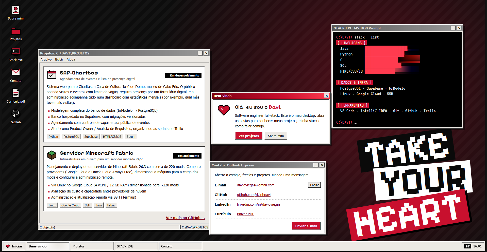

# dzinhoOS 98

**O portfólio de Davi ([@dzinhoavi](https://github.com/dzinhoavi)): um desktop retrô que roda no navegador.**

*Take Your Heart.*

[**Acessar o site →**](https://portifolio-site.vercel.app)

---

## Sobre

Em vez de mais um portfólio de página única, montei um **sistema operacional fictício no estilo Windows 95/98**, nas cores vermelho, branco e preto. Cada parte do portfólio é uma janela: dá para abrir, arrastar, minimizar e alternar entre elas pela barra de tarefas, como num desktop de verdade.

Tudo foi feito **sem frameworks e sem bibliotecas**: HTML, CSS e JavaScript puros, com o gerenciador de janelas escrito do zero.

## O que tem dentro

| Janela | Conteúdo |
|---|---|
| **Sobre mim** | Quem eu sou, formação e o que gosto de fazer |
| **Projetos** | SAP-Charitas e o servidor Minecraft Fabric |
| **Stack.exe** | Minhas linguagens e ferramentas num prompt estilo MS-DOS |
| **Contato** | E-mail, GitHub, LinkedIn e currículo |

## Destaques

- **Tela de boot** estilo BIOS na primeira visita
- **Gerenciador de janelas próprio**: arrastar, focar, minimizar e fechar, além de barra de tarefas e menu Iniciar
- **Bilíngue (PT/EN)**: detecta o idioma do navegador e alterna com um clique na bandeja
- **Responsivo**: no celular, as janelas viram telas cheias e os ícones abrem com um toque
- **Acessível**: navegação por teclado e respeito a `prefers-reduced-motion`
- **Leve**: zero dependências e nenhuma etapa de build

## Projetos em destaque

**SAP-Charitas**: sistema web de agendamento de eventos e lista de presença digital para o Charitas (Casa de Cultura José de Dome, Cabo Frio). Fiz a modelagem do banco em PostgreSQL/Supabase, o agendamento com limite de vagas e o dashboard de visitas.

**Servidor Minecraft Fabric**: infraestrutura em nuvem para um servidor modado (cerca de 220 mods) rodando 24/7 numa VM Linux, com administração remota via SSH.

---

**Davi** · Software Engineer full-stack · Universidade Veiga de Almeida

[GitHub](https://github.com/dzinhoavi) · [E-mail](mailto:davioviegas@gmail.com)

